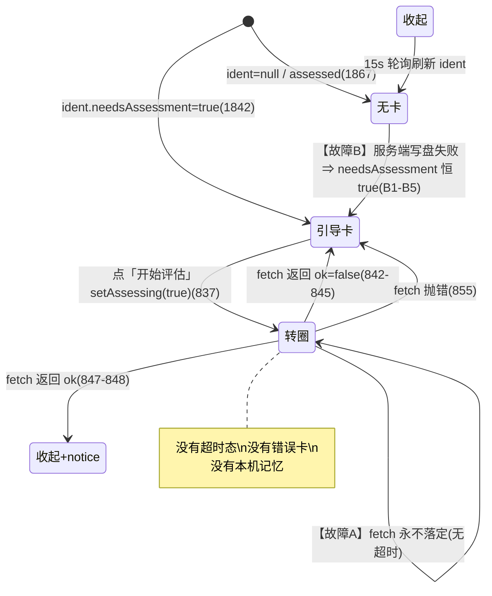
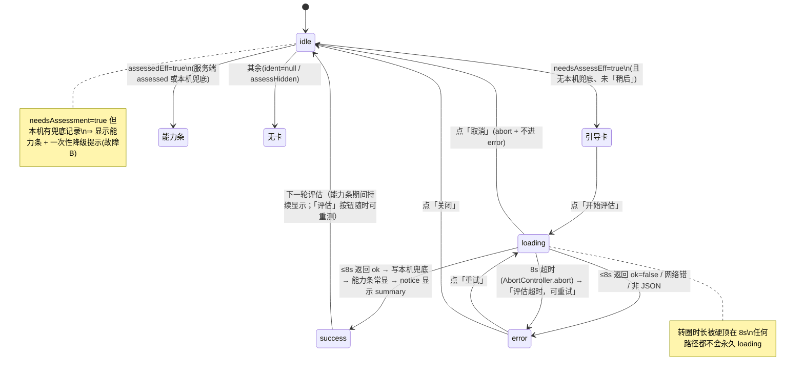

# dsh-job-board UI 2.7.4 —— 评估卡四态 + 评估状态一致性 设计文档

- 基线：v2.7.3 干净导出（commit `0380ced`），工作目录 `C:\work\dsh-job-board-ui-2.7.4`
- 范围：仅 `lib/client.js`、`scripts/client-render-smoke.mjs`、`docs/ui-2.7.4/`
- 明确不改：`lib/index.js`（服务端）、`CHANGELOG.md`、`package.json`、任何版本号
- 依据：`docs/release-work-instruction.md`（WI-001）§2/§4（负向门禁、数据翻转）；`scripts/check-text.mjs`（LF / UTF-8 无 BOM / 无控制字符）

> 行号约定：`client.js:NNN` / `index.js:NNN` 均为 **2.7.3 基线**的行号（改前）；改后行号见 patch.diff 与 self-review.md。

---

## 1. 故障与根因（带真实行号的证据链）

### 故障 A：本机「工作评估」卡片挂住不返回（永久转圈）

| # | 位置 | 事实 |
|---|---|---|
| A1 | `client.js:835-857` | `runAssess` 用裸 `fetch(API + '/assess', …)`（839 行），**无任何超时/中止机制**（全文件 0 处 `AbortController`，已 grep 验证） |
| A2 | `client.js:837` | `setAssessing(true)` 后，只有 fetch 链落定才会 `setAssessing(false)`（856 行）；且链尾的 `.then(() => setAssessing(false))` 是 promise 链的"finally"——**/assess 无响应时 fetch 永不落定，整条链（含 finally）都不走，`assessing` 永久卡 true**（复核方确认的成因②） |
| A3 | `index.js:1013` | `assess(force)` → `index.js:1024` `reportCaps({ force: true })`；能力探测是异步 execFile 并发探针（`index.js:845-851`，单探针 `timeout: 3000`），但探测前的上游（板子/上报链路）卡住时 fetch 永不落定 |
| A4 | `client.js:1863 / 1903` | 按钮 `disabled: assessing` + 文案「评估中…」→ 永久转圈，唯一出路是刷新整页 |

根因一句话：**评估请求没有客户端超时，服务端卡住 = 客户端永久 loading**。违反 WI-001 §4「降级可见」与本次硬要求「绝不允许永久转圈」。

### 故障 B：副机评估完（结果与上次一致），切「对话」再点回面板，又要求重新评估

| # | 位置 | 事实 |
|---|---|---|
| B1 | `index.js:817-827` | `saveIdentity(caps)` 写 `IDENTITY_FILE`；**失败分支只 `trace('identity save failed …')` 后返回 null（825-826 行），不重试、不补偿** |
| B2 | `index.js:829-837` | `identityState()`：`same = !!(rec && rec.machine === cfg.machine)`，`needsAssessment = !same`（836 行）。**写盘失败 ⇒ rec 缺失/机器不匹配 ⇒ `needsAssessment` 恒 true** |
| B3 | `client.js:818-833` | 面板挂载时拉 `/identity`（821 行）并 15 秒轮询（828 行）；`ident.needsAssessment` 直接驱动评估卡 |
| B4 | `client.js:1842-1866` | `ident && ident.needsAssessment && !assessHidden ? 引导卡 : …` |
| B5 | 面板切换形态 | 切到「对话」再点回面板 = Panel 组件**重挂载**：`ident` 回到初始 `null`（`client.js:753`），重新走 B3 |
| B6 | `client.js:759` | `assessHidden` 是 **Panel 局部 state**：面板重挂即重置为 false——即使上次评估成功时把区域收起（基线 848 `setAssessHidden(true)`），这份记忆也随重挂消失。也就是说基线里「已评估」相关的两个状态（服务端派生的 `needsAssessment`、局部的 `assessHidden`）**都没有跨重挂的落定**，这就是切面板又弹评估的第二条成因（复核方确认的成因①） |

根因一句话：**评估成功这一事实只存在于服务端磁盘（`saveIdentity`）一处；写盘失败后客户端对「我刚评过」零记忆，每次重挂都被 `needsAssessment=true` 重新拉回引导卡**。评估接口返回值（`index.js:1029-1041`）里有 `machine/caps/summary`，但客户端成功后只把 `assessHidden` 置 true（`client.js:848`），没有做任何持久化。

---

## 2. 改什么、为什么

### 2.1 评估卡状态机（client.js，修故障 A）

新增组件状态 `assessPhase ∈ {idle, loading, success, error}`（与 `assessErr` 错误详情），替代原布尔 `assessing` 承担「评估中」职责：

| 旧 | 新 |
|---|---|
| `assessing: boolean`（754 行） | `assessPhase: 'idle' \| 'loading' \| 'success' \| 'error'` + `assessErr: string` |
| fetch 无超时 | `AbortController` + 8 秒超时（`ASSESS_TIMEOUT_MS = 8000`），超时 → `error` 态，错误卡带「重试」按钮 |
| loading 只有按钮文案「评估中…」 | 专属 loading 卡：明确文案「最长 8 秒、超时会提示重试」+「取消」按钮（同步 abort） |
| error 只写 `notice` 文案（843/855 行） | 专属 error 卡：错误原因 + **重试**（重新 `runAssess`）+ 关闭（回 idle） |
| 成功只 `setAssessHidden(true)` | success 态：写本机兜底记录（见 2.2）+ 能力条/提示正常出现 |

为什么保留 `notice`：notice 是面板全局提示条，评估成功摘要（服务端 `summary`）仍走 notice；但 loading/error 有了专属卡片，不再依赖全局文案传达关键状态。

### 2.2 评估结果本机兜底（client.js，修故障 B）

服务端不能改 ⇒ 在客户端给「评估成功过」建立第二事实源：

- 新增 localStorage 键（全部 `try/catch` 包裹，隐私模式/禁用 localStorage 时静默退化为旧行为）：
  - `dsh-assess-done-v1`：`{ machine, assessedAt }`，assess 成功（`d.ok !== false`）时写入（机器名取响应 `d.machine`，`index.js:1030` 保证存在）
  - `dsh-assess-degrade-notified-v1`：一次性降级提示的「已提示」标记
- `/identity` 轮询返回 `needsAssessment: true` 时（`client.js:823` 的 then 内）：
  1. 读本机兜底记录；`marker.machine === d.machine` ⇒ **合并**：`needsAssessment:false, assessed:true, assessedAt: marker.assessedAt`；
  2. 且若「已提示」标记不存在 ⇒ `setNotice` 一次性降级提示（内容：服务端档案写盘失败、已用本机记录代替、可点重新评估重写档案），然后写入标记 —— **第一次提示、之后不重复弹**；
  3. 返回 `needsAssessment: false` 时清掉「已提示」标记（下次再失败还能提示一次）。
- 渲染期二次派生（双保险）：卡片渲染前按同一 `readLocalAssess()` 派生 `needsAssessEff / assessedEff`。轮询覆盖、提示标记丢失、时序竞态下渲染结果依然正确。
- 「稍后」按钮（1864 行）原来只改内存 `ident.needsAssessment:false`，15 秒轮询即翻回（原有缺陷，本次顺带修）：点「稍后」额外记 `assessLater`（按当前机器），派生时一并排除。
- 机器切换保护：`marker.machine !== d.machine` 时不合并 —— 机器改名/换机后老老实实重新引导评估，不会拿旧机器的评估冒充。

### 2.3 冒烟用例（scripts/client-render-smoke.mjs）

- 新增第 4 轮：评估卡四态渲染断言 + 交互式超时链路（可重渲染的假 React，见 smoke-cases.md）。
- 新增 6 条**无条件**静态断言（`RAW.includes`）：超时常量、AbortController、两个 localStorage 键、phase 判断、降级提示文案 —— 旧 bundle（`case/lib-client-2.7.0-crash.bak`）在这些断言上全部 FAIL，满足「新用例必须能抓住旧 bug」。
- 假 React 升级为可重渲染（`useState` setter 真实生效、组件函数可重调），原有用例行为不变。

### 2.4 h() 首参静态扫描（docs/ui-2.7.4/scan-h-type.mjs，一次性脚本）

对 `lib/client.js` 每个调用形如 `h(...)` 的首参做静态扫描：只允许**字符串字面量**或**函数组件标识符**（本包实际只有字符串字面量）。这正是 React #130（`h(h('div'),…)`，2.7.0 事故）的机械防线。脚本对旧 bundle 跑会精确抓出崩溃点（负向验证）。

### 2.5 复核意见正面回应（两处确认机制 × 三项覆盖要求）

复核方确认：① `assessHidden` 是 Panel 局部 state（基线 `client.js:759`），重挂即重置，是「切面板又弹评估」的成因之一；② `runAssess`（基线 `:835-857`）在 /assess 无响应时链尾 finally 不执行，`assessing` 永久卡 true，是「挂住」的成因。两条均已在 §1 的 A2/B6/B5 证据链中收录。本设计的修复对「超时兜底、成功后两个 state 都落定、轮询不顶回」的覆盖映射如下：

| 复核要求 | 本设计的对应机制 | 代码位置（改后） | 断言位置 |
|---|---|---|---|
| 超时兜底（finally 必须可达） | 三层：a) `ASSESS_TIMEOUT_MS=8000` 定时器主动 `abort()`，强制 promise 链必然落定（reject），链尾 finally 因此**总能执行**；b) 清理段（`clearTimeout` + `assessAbortCtl=null`）挂在链尾 `.then`，成功/服务端拒绝/超时/取消/网络错五条路径全覆盖；c) 取消与超时的竞态由 `assessCancelRequested` 标记仲裁（取消路径不进 error） | `client.js:923-931`（定时器）、`976-979`（链尾清理）、`961-974`（catch 三分类） | smoke 4-4a/b/c 交互链；S1/S2/S3 静态断言 |
| 成功后 `needsAssessment` 落定 | 三重保证：a) 成功即写本机兜底 `dsh-assess-done-v1`（机器名取响应 `d.machine`）；b) 成功后二段拉取 /identity 刷新 ident，服务端档案正常则直接落定为已评估；c) 服务端写盘失败时，轮询合并 + 渲染期派生把 `needsAssessment=true` 压成「已评估」 | `client.js:950`（写兜底）、`952-958`（二段刷新）、`880-888`（轮询合并）、`907-912`（渲染派生） | smoke 4-5c（兜底落盘）、4-6（翻转不弹回） |
| 成功后 `assessHidden` 落定 | 成功路径显式 `setAssessHidden(true)` 收起引导形态；针对复核①「重挂重置」：`assessHidden` 的职责被限定为**本会话内用户主动收起**，跨重挂的「已评估」事实由兜底记录承担——重挂后 `assessHidden=false`，但 `needsAssessEff` 因兜底为 false、`assessedEff` 为 true，渲染的是能力条而非引导卡，「待评估」形态无法重现 | `client.js:951`（成功收起）、`907-912`（重挂后的派生） | smoke 4-5b（引导卡消失）、4-6（重挂形态 = 能力条） |
| /identity 轮询不把已完成的评估顶回待评估 | 轮询回调进入即查兜底：`needsAssessment=true && marker 匹配` ⇒ 合并为已评估并 return，不再透传原始值；渲染期派生为第二保险（即使合并未跑，渲染结果也正确）；「已提示」标记在服务端档案恢复时清零，保证降级提示可再触发 | `client.js:880-888`（轮询合并）、`890-893`（标记清零）、`907-912`（派生双保险） | smoke 4-6（15s 轮询等价形态：重挂重新拉 /identity）；self-review R2-⑦ |

---

## 3. 状态机对比

### 3.1 改前（2.7.3 基线）

### 3.2 改后

### 3.3 状态/变量对照表（改后）

| 状态 | `assessPhase` | 主导变量 | 卡片渲染 | 退出条件 |
|---|---|---|---|---|
| 引导 | idle | `needsAssessEff`（=needsAssessment ∧ 无兜底 ∧ ¬later ∧ ¬hidden） | 黄框引导卡：「开始评估」「稍后」 | 点评估→loading；点稍后→无卡 |
| 加载 | loading | fetch 进行中，8s 定时器在跑 | loading 卡：「评估中…最长 8 秒」+「取消」 | 成功/失败/超时/取消 |
| 成功 | success | `d.ok` | 能力条**持续显示**（success 派生分支忽略 `assessHidden`，评估结果立即可见），notice=summary | 下次评估 |
| 失败 | error | `assessErr`（超时/服务端/网络三类） | 红框错误卡：原因 +「重试」「关闭」 | 重试→loading；关闭→idle |

---

## 4. 边界态清单（六态全覆盖）

| 态 | 触发 | 改前行为 | 改后行为 | 断言位置 |
|---|---|---|---|---|
| loading | 点「开始评估」 | 按钮文案「评估中…」，无时限 | loading 卡 + 8s 硬顶 + 可取消 | smoke #4-2 / #4-4 |
| success | assess 返回 ok | 收起区域，notice=summary | 能力条常显（结果立即可见）+ notice=summary + **写本机兜底记录**（`dsh-assess-done-v1`） | smoke #4-5 |
| error | 返回 `ok:false` / HTTP 非 2xx / 非 JSON / 网络抛错 | notice 一行字，卡片形态不变 | error 卡（原因 + 重试 + 关闭） | smoke #4-3 |
| timeout | 8 秒无响应（故障 A 主场景） | **永久转圈** | error 卡，文案明确「评估超时（8 秒）…可重试」 | smoke #4-4（交互链） |
| empty | `ident=null`（identity 未拉到）/ `caps` 空清单 | 整卡不渲 / 「（清单为空，点右按钮重测）」 | 不变（原有语义保留） | smoke 第 1 轮回归 |
| 数据翻转 | needsAssessment true→false（评估成功）→true（写盘失败/轮询覆盖） | 翻回 true ⇒ 引导卡反复弹（故障 B） | 本机兜底派生 ⇒ 保持能力条；首次给一次性降级提示，之后不重复弹 | smoke #4-6 |

补两个隐性边界：

| 场景 | 行为 |
|---|---|
| localStorage 不可用（隐私模式） | 三个 helper 全 try/catch：兜底失效，退化为 2.7.3 原行为，不抛错 |
| 机器改名/换机（marker.machine ≠ d.machine） | 不合并兜底 ⇒ 正常引导重新评估 |
| 「取消」与「超时」竞态 | `assessCancelRequested` 标记：取消路径不进 error 态 |
| 组件卸载后定时器触发 | 与 2.7.3 同形态（setState on unmounted 不抛错，React 18 无警告），定时器在 fetch 链 finally 中 `clearTimeout`，不泄漏 |

---

## 5. 明确不做（及理由）

1. **不改 `lib/index.js`**：任务禁改。服务端遗留风险（`saveIdentity` 写盘失败只 trace，`index.js:825-826`）在 self-review.md 中列为「建议后续版本处理」，本版用客户端兜底消化。
2. **不动 `assessHidden` / 「评估」重开按钮（`client.js:1704`）**：沿用 2.2.0 语义。
3. **不动 `/identity` 15 秒轮询周期（`client.js:828`）**：故障 B 由兜底派生消化，改轮询属无关重构。
4. **不动 `notice` 的其他 27 处使用点**。
5. **不加 service worker / 离线缓存**：超出本次故障域。

---

## 6. 无障碍与打磨要点（UI 底线）

- 评估卡 loading/error 态文案完整成句，不依赖颜色单独传达（配文字说明，WCAG 1.4.1）。
- 「重试」「取消」「关闭」按钮复用现有 `dsb-btn` 样式钩子（键盘可达、焦点样式随全局主题），触摸目标与现有按钮一致（≥44px 高，由 `dsb-btn` 全局样式保证）。
- 错误卡边框色沿用 `--dsb-bad` 语义令牌，与 doctor 红条（`client.js:1911`）同源，不新增颜色。
- 文案克制：不堆感叹号，超时提示给出明确下一步（「可点重试」）。

---

## 7. 交付物索引

| 文件 | 内容 |
|---|---|
| `docs/ui-2.7.4/design.md` | 本文档 |
| `docs/ui-2.7.4/patch.diff` | `lib/client.js` + `scripts/client-render-smoke.mjs` 的 unified diff（可直接 `git apply`） |
| `docs/ui-2.7.4/smoke-cases.md` | 新增冒烟用例清单 + 每条断言 |
| `docs/ui-2.7.4/self-review.md` | 三轮自审（逐分支枚举 / 反证 / 回归） |
| `docs/ui-2.7.4/scan-h-type.mjs` | h() 首参静态扫描（一次性脚本，含负向验证结果） |
| `lib/client.js` | 评估卡四态 + 超时重试 + needsAssessment 本机兜底 |
| `scripts/client-render-smoke.mjs` | 第 4 轮用例 + 可重渲染假 React + 6 条静态断言 |
